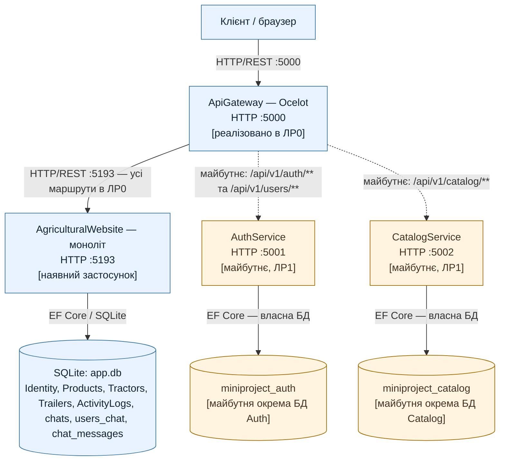

# Діаграма 1. Композиція системи AgriculturalWebsite

**Легенда:** суцільні стрілки — реальні зв’язки в ЛР0; пунктирні — цільова архітектура наступних робіт. AuthService і CatalogService та їхні бази даних у ЛР0 ще не реалізовані.

**Порти:** Gateway — `5000`, наявний моноліт — `5193` (з його `launchSettings.json`), майбутній AuthService — `5001`, майбутній CatalogService — `5002`. Порти майбутніх сервісів узгоджені з методичкою ЛР1; порт моноліту `5193` збережено відповідно до фактичного проєкту, а не замінено навчальним прикладом `5100`.

У майбутньому кожен сервіс володітиме власною БД (`miniproject_auth` і `miniproject_catalog`). Прямий доступ одного сервісу до БД іншого не передбачається.
