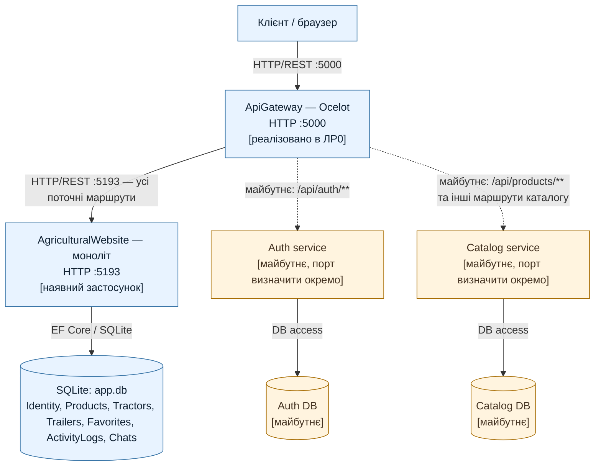

# Діаграма 1. Композиція системи AgriculturalWebsite

Легенда: суцільні стрілки — поточні виклики ЛР0; пунктирні стрілки — цільовий стан наступних робіт. Усі маршрути шлюзу наразі ведуть до моноліту.
