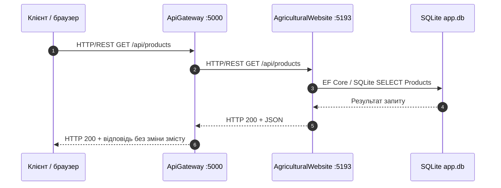

# Діаграма 2. Поточний сценарій: перегляд товарів через шлюз

Це поточний шлях: шлюз лише перенаправляє запит. Фізичний файл БД — `src/Monolith/app.db`; порт моноліту взято з наявного `Properties/launchSettings.json` (`5193`).
