# Дорожня карта виконання лабораторних робіт (ЛР0 — ЛР4)
## Проєкт: AgriculturalWebsite (Мікросервісна трансформація)

Цей документ об'єднує всі вимоги, архітектурні кроки, критерії оцінювання та бонуси лабораторного циклу з міграції моноліту аграрної платформи на мікросервісну архітектуру.

---

## 1. Загальна схема трансформації системи

```mermaid
flowchart TD
    subgraph LR0_State["ЛР0: Шлюз перед монолітом"]
        C0[Клієнт] -->|HTTP :5000| GW0[ApiGateway: Ocelot]
        GW0 -->|HTTP :5193| M0[Моноліт AgriculturalWebsite]
        M0 --> DB0[(app.db SQLite)]
    end

    subgraph LR1_State["ЛР1: Винесення Auth та Catalog"]
        C1[Клієнт] -->|HTTP :5000| GW1[ApiGateway]
        GW1 -->|/api/v1/auth/**| A1[AuthService :5001]
        GW1 -->|/api/v1/catalog/**| Cat1[CatalogService :5002]
        GW1 -->|решта| M1[Моноліт :5193]
        A1 --> DBA1[(miniproject_auth)]
        Cat1 --> DBC1[(miniproject_catalog)]
    end

    subgraph LR2_State["ЛР2: Винесення Operations (Оренда / Замовлення)"]
        C2[Клієнт] -->|HTTP :5000| GW2[ApiGateway]
        GW2 --> A2[AuthService :5001]
        GW2 --> Cat2[CatalogService :5002]
        GW2 -->|/api/v1/rentals/**| Op2[AgriOperationsService :5003]
        GW2 --> M2[Моноліт :5193]
        Op2 -->|gRPC :5102| Cat2
        Op2 --> DBO2[(miniproject_operations)]
    end

    subgraph LR3_State["ЛР3: Розширення Gateway (Smart Gateway)"]
        C3[Клієнт] -->|HTTP :5000| GW3[ApiGateway: Composite + Cache + RateLimit + Token Check]
        GW3 -->|X-User-Id / X-User-Roles| A3[Auth :5001]
        GW3 -->|X-User-Id| Cat3[Catalog :5002]
        GW3 -->|X-User-Id| Op3[Operations :5003]
        GW3 -.->|Композит: деталі техніки + активні оренди| Cat3 & Op3
    end

    subgraph LR4_State["ЛР4: Клієнтський UI застосунок"]
        UI[Клієнтський застосунок: Blazor / React / Vue / HTML+JS] -->|Єдина точка входу HTTP :5000| GW4[ApiGateway]
    end
```

---

## 2. Матриця компонентів, портів і баз даних

| Компонент | Порт HTTP | Порт gRPC | База даних | Стан на ЛР0 | Стан на ЛР4 |
|---|---|---|---|---|---|
| **API Gateway** | `5000` | — | — | Маршрутизатор Ocelot | Smart Gateway (композит, кеш, rate limit, auth) |
| **AuthService** | `5001` | — | `miniproject_auth` | У моноліті | Окремий сервіс (JWT, ролі, refresh token) |
| **CatalogService** | `5002` | `5102` | `miniproject_catalog` | У моноліті | Окремий сервіс (Products, Tractors, Trailers, Categories) |
| **OperationsService** (Rental/Order) | `5003` | `5103` | `miniproject_operations` | Частково в моноліті | Окремий сервіс (оренда техніки / замовлення, ідемпотентність) |
| **Моноліт (залишок)** | `5193` (або `5100`) | — | `app.db` | Обслуговує все | Лише MVC сторінки, чати або повністю виведений |
| **Client UI App** | `3000` / `5173` / `5200` | — | Локальний storage токенів | Відсутній | Повноцінний UI (5 обов'язкових екранів, 4 стани) |

---

## 3. Таблиця зв'язку предметної області AgriculturalWebsite

| Модуль | Сутності AgriculturalWebsite | Операції та бізнес-правила | Призначений сервіс |
|---|---|---|---|
| **Ідентифікація та користувачі** | `ApplicationUser`, `IdentityRole`, `RefreshToken` | Реєстрація, логін, оновлення пари токенів, зміна ролей | **AuthService** (`:5001`) |
| **Каталог агротехніки та товарів** | `Product`, `Tractor`, `Trailer`, `Category` | Пагінація, фільтри (ціна, потужність), сортування, CRUD (Admin) | **CatalogService** (`:5002`) |
| **Операції над каталогом** | `AgriRental` / `AgriOrder`, `ItemSnapshot`, `IdempotencyLog` | Бронювання/оренда трактора або купівля товару, перевірка через gRPC, скасування | **OperationsService** (`:5003`) |
| **Агрегований перегляд** | `EquipmentDetailsViewDto` (Трактор + активна оренда користувача) | Паралельний виклик `Catalog` + `Operations` через `Task.WhenAll`, часткова деградація | **ApiGateway** (`:5000`) |
| **Комунікації та журнал (legacy)** | `Chat`, `ChatMessage`, `ActivityLog` | SignalR-чати та системні логи моноліту | **Monolith** (або окремі утиліти) |

---

## 4. Швидкий огляд робіт

1. **[ЛР0: Проєктування декомпозиції та шлюз перед монолітом](./LR0-decomposition-gateway.md)**
   - Налаштування Ocelot перед існуючим монолітом без зміни коду моноліту.
   - Створення ADR-0001, ADR-0002 та 3-х C4-діаграм.
   - Перевірка `/health`, логування та `X-Correlation-Id`.

2. **[ЛР1: Auth-сервіс і Catalog-сервіс](./LR1-auth-catalog-services.md)**
   - Винесення `AuthService` (порт `5001`) та `CatalogService` (порт `5002`).
   - Принцип Database-per-service (окремі DbContext, без спільних FK та JOIN).
   - JWT access (15 хв) + refresh token (з ротацією та криптографічним генератором `RandomNumberGenerator`).
   - Пагінація, сортування, фільтрація, DTO, OpenAPI/Swagger з Bearer auth.

3. **[ЛР2: Винесення операційного сервісу та інтеграційні тести](./LR2-operations-service-and-tests.md)**
   - Вибір та винесення операційного сервісу: `AgriRentalService` (оренда тракторів/техніки).
   - Міжсервісний виклик до Catalog через gRPC з дедлайном (2 сек) та обробкою 3 станів помилок.
   - Ідемпотентність POST через заголовок `Idempotency-Key`.
   - Фіксація `ItemSnapshot` (щоб зміна ціни в каталозі не спотворювала історію замовлень).
   - Baseline-тестування (зняття відповідей моноліту ДО змін) та мінімум 8 інтеграційних тестів.

4. **[ЛР3: Розширення API Gateway](./LR3-gateway-composite-cache-ratelimit.md)**
   - Складений запит (екран деталі техніки + активні оренди користувача) з паралельним `Task.WhenAll`.
   - Локальний кеш в пам'яті (`IMemoryCache`) для каталогу з обґрунтованим TTL та інвалідизацією при мутаціях.
   - СУВОРЕ правило: жодного кешування персональних даних!
   - Rate limiting: окремі ліміти для анонімів (по IP) та авторизованих (по `X-User-Id`), жорсткий ліміт для `/auth/login`, код 429 з заголовком `Retry-After`.
   - Перенесення автентифікації на шлюз та прокидання `X-User-Id` вниз у внутрішні сервіси.
   - Єдиний формат помилок `ProblemDetails` (RFC 9457). Мінімум 5 інтеграційних тестів шлюзу.

5. **[ЛР4: Клієнтський застосунок та презентація](./LR4-client-application-and-presentation.md)**
   - Клієнтський застосунок (Blazor / React / Vue / HTML+JS) без прямого звернення до сервісів (лише через `:5000`).
   - 5 обов'язкових екранів: Вхід, Каталог, Деталі техніки (1 складений запит), Оформлення оренди, Мої оренди.
   - 4 стани для кожного екрана: Завантаження (disabled кнопки), Успіх, Порожньо, Помилка з кнопкою «Повторити».
   - Централізований шар API (`AuthHandler`: автоматичний Bearer, перехоплення 401 з оновленням через refresh token).
   - Захист від подвійного кліку та передача клієнтського `Idempotency-Key`.
   - Презентація архітектурних рішень (5-8 слайдів).

---

## 5. Додатковий аудит помилок та колізій між методичками

Обов'язково ознайомтеся з документом **[Аудит суперечностей та пасток між методичками](../analysis/cross-lab-conflicts-and-traps.md)** перед реалізацією наступних етапів!
